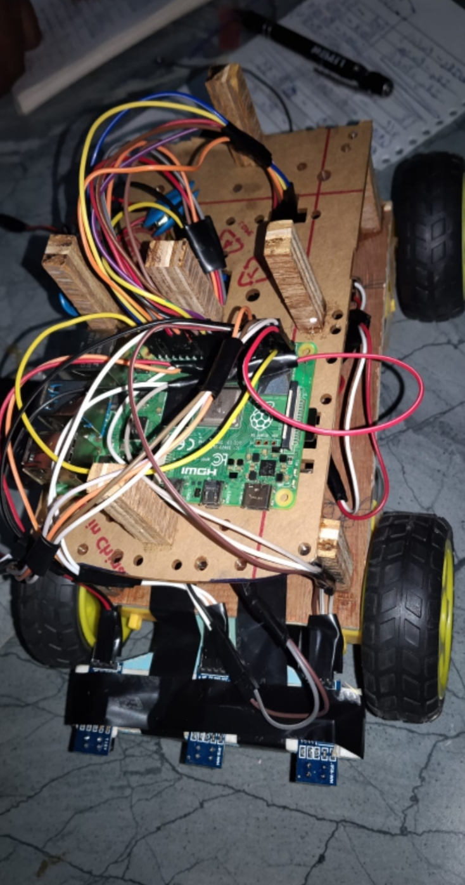
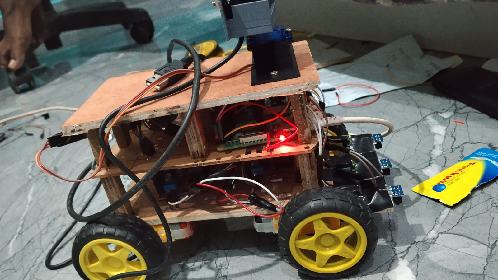
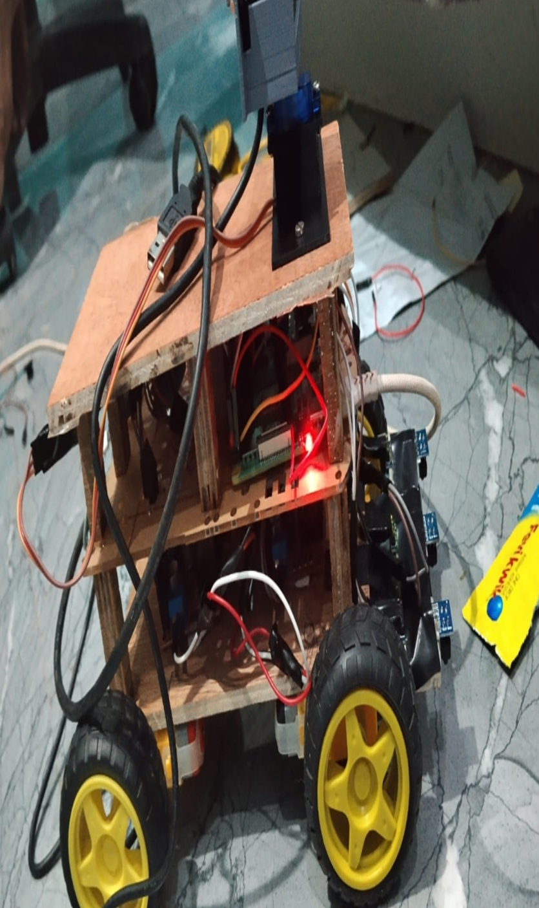
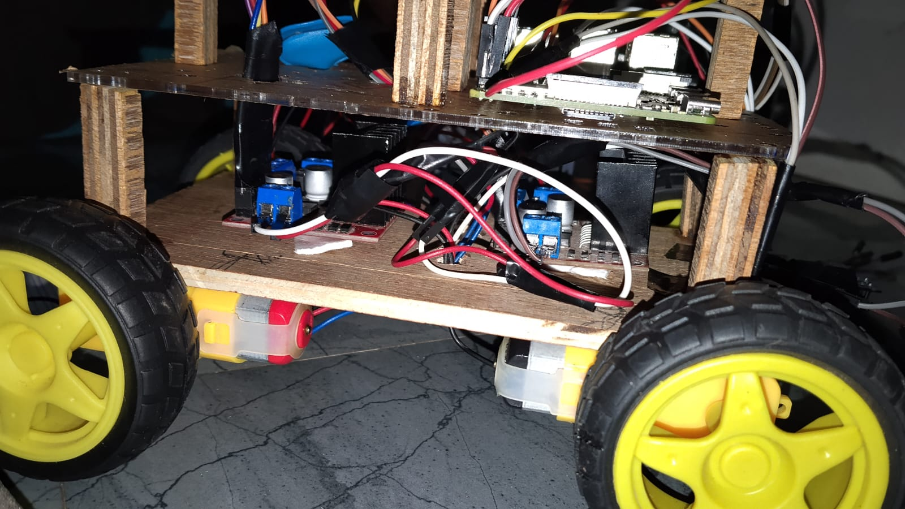
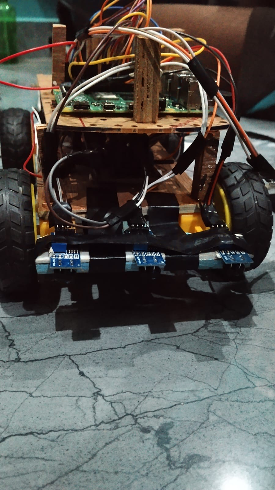
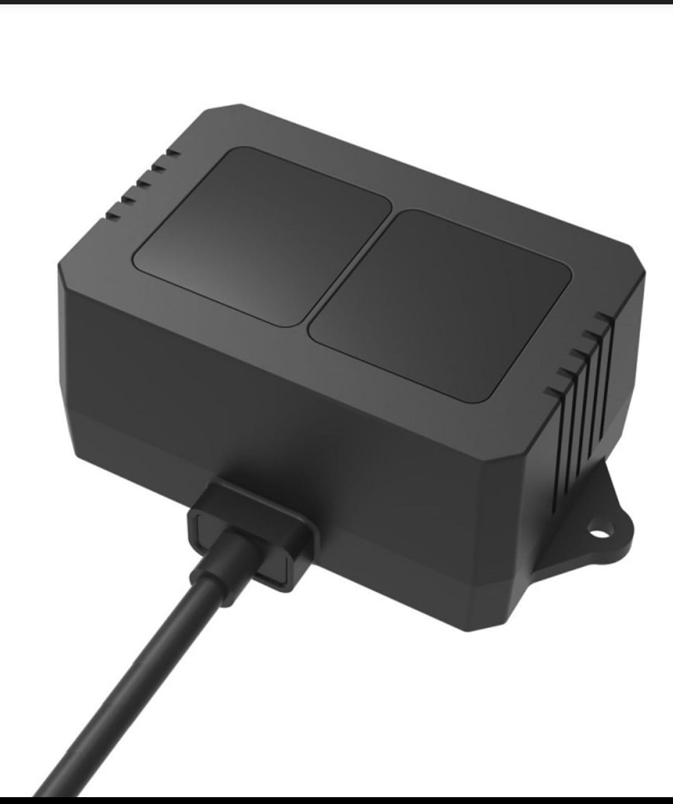
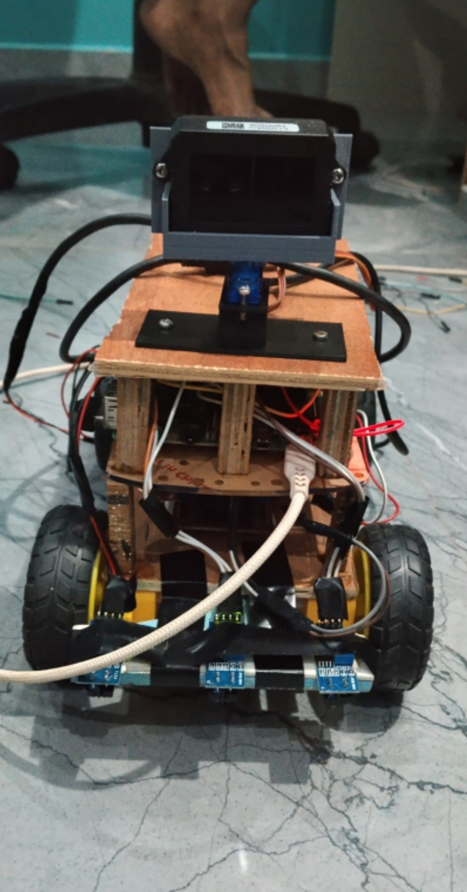

# Autonomous Voice-Controlled Line-Following Robot

An autonomous mobile robot that follows a predefined black-line track, accepts voice-based destination input, detects obstacles using LiDAR, and provides audio alerts. An ESP32-based subsystem drives two OLED displays for expressive robot animations.

## Project Highlights

- **Line Following:** Three IR sensors detect and track a black line.
- **Voice-Based Destination Selection:** Choose a destination using voice input.
- **Obstacle Detection:** TF02 Pro LiDAR measures the distance to obstacles.
- **Obstacle Handling:** Stops, provides an audio alert, and uses the implemented obstacle-handling logic.
- **Audio Feedback:** Provides voice alerts and destination notifications.
- **Animated Robot Face:** An ESP32 controls two 1.3-inch OLED displays for facial expressions. The ESP32 currently operates separately from the Raspberry Pi.

## System Architecture

See [System Architecture](docs/system-architecture.md) for the system diagram and controller responsibilities.

## Hardware Components

| Component | Purpose |
|---|---|
| Raspberry Pi 4B | Main robot controller |
| ESP32 DevKit | OLED facial-expression controller |
| 2 × 1.3-inch OLED displays | Robot face and expressions |
| 3 × TCRT5000 IR sensors | Line detection |
| TF02 Pro LiDAR | Obstacle-distance measurement |
| 2 × L298N motor drivers | Motor control |
| 4 × DC geared motors | Robot movement |

## Robot Photos

### Complete Robot





### Hardware Details







### LiDAR Sensor



### Front View




## Robot Demonstration Videos

### Robot Movement and Response

[Watch the robot movement video](videos/robot-movement.mp4)

### OLED Eye-Blinking Animation

[Watch the OLED eye animation](videos/oled-eye-blinking.mp4)


## Repository Structure

```text
autonomous-voice-controlled-line-following-robot/
├── docs/
│   ├── system-flow.md
│   └── system-architecture.md
├── hardware/
│   └── pinout.md
├── images/
├── src/
│   ├── audio.py
│   ├── displaytest.py
│   ├── line_follower.py
│   ├── main.py
│   ├── motors.py
│   ├── obstacle_test.py
│   ├── robot.py
│   └── requirements.txt
└── README.md
```

## Team

- D. Kavya
- Donthi Sai Preethi
- S. Nitin
- D. Jonathan
