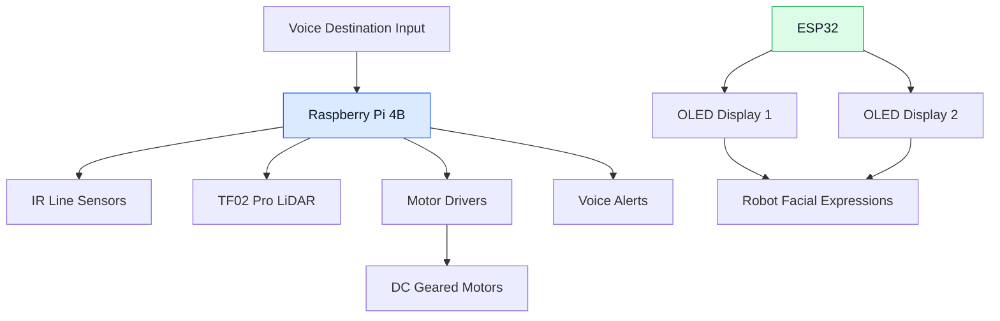

# System Architecture

## 1. Project Overview

The Autonomous Voice-Controlled Line-Following Robot uses a Raspberry Pi 4B for robot control and an ESP32 to drive two OLED displays for facial expressions.

The robot follows a predefined black-line track, detects obstacles using a TF02 Pro LiDAR sensor, and provides voice-based destination and obstacle alerts.

## 2. System Architecture Diagram

## 3. Main Components

| Component | Function |
|---|---|
| Raspberry Pi 4B | Main robot controller |
| Three IR sensors | Detect the black line |
| TF02 Pro LiDAR | Measure distance to obstacles |
| Two motor drivers | Control motor movement |
| Four DC geared motors | Move the robot |
| ESP32 DevKit | Control the OLED displays |
| Two 1.3-inch OLED displays | Show facial expressions |
| Audio system | Provide destination and obstacle alerts |

## 4. Controller Responsibilities

### Raspberry Pi 4B
- Reads the IR line sensors.
- Controls the motors through the motor drivers.
- Reads obstacle distance measurements from the LiDAR.
- Runs the robot's navigation logic.
- Handles voice input and audio alerts.

### ESP32
- Controls both OLED displays.
- Displays facial expressions and animations.
- Currently operates separately from the Raspberry Pi.

## 5. Current Integration Status

The Raspberry Pi and ESP32 are not yet connected for communication. The OLED display subsystem is therefore documented separately from the main robot controller.

Communication between the two controllers may be added in a future development stage.

## 6. Navigation Workflow

1. Select a destination using voice input.
2. Follow the predefined black-line track.
3. Monitor obstacle distance using the LiDAR.
4. Stop and provide an alert when an obstacle is detected.
5. Resume navigation when the obstacle-handling logic permits.
6. Provide a voice notification upon reaching the destination.
